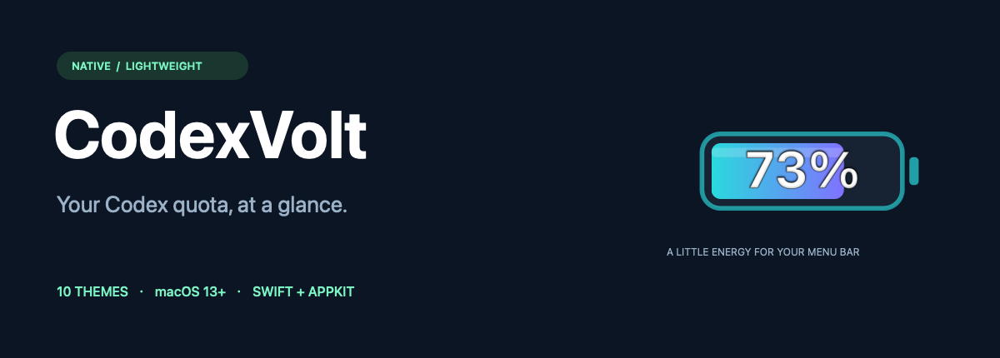
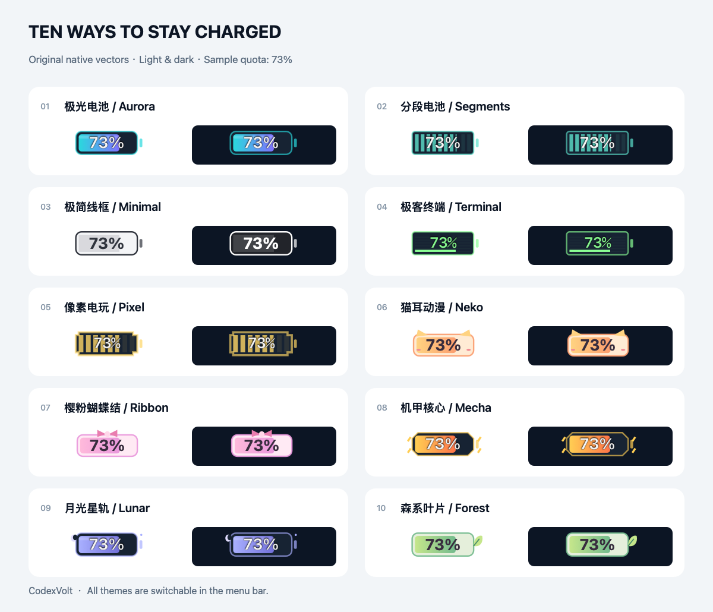

<p align="center"></p>

<p align="center">
  <strong>把 Codex 剩余额度，变成菜单栏里的一块小电池。</strong><br>
  原生 Swift · 十款主题 · 图标内百分比 · 轻量运行
</p>
<p align="center">
  <a href="https://github.com/xx1999DK/CodexVolt/releases/latest">下载安装</a> ·
  <a href="README.en.md">English</a> ·
  <a href="LICENSE">MIT License</a>
</p>

## 看一眼，就知道还能用多少

CodexVolt 是独立开发的 macOS 菜单栏小工具。它复用本机 Codex CLI 的登录状态，读取账户额度，将**剩余百分比直接绘制在图标内部**。点击图标可查看额度窗口、重置时间和设置。



| 风格 | 主题 |
|---|---|
| 光效与电量 | 极光电池、分段电池 |
| 简约与极客 | 极简线框、极客终端 |
| 游戏与动漫 | 像素电玩、猫耳动漫 |
| 少女与科幻 | 樱粉蝴蝶结、机甲核心 |
| 夜空与自然 | 月光星轨、森系叶片 |

菜单中可立即切换主题，也可打开十款外观选择器；选择会自动保存。展示图使用虚构的 73% 示例值，由应用相同的原生绘制代码生成。

## 安装

**要求：macOS 13+、已安装并登录的官方 Codex CLI。** 应用不会捆绑 CLI，也不包含独立登录流程。

1. 从 [Releases](https://github.com/xx1999DK/CodexVolt/releases/latest) 下载适合电脑的 ZIP。Apple Silicon 使用 `arm64`；Intel 使用 `x86_64`（已交叉编译，尚未实机验证）。
2. 解压，把 `CodexVolt.app` 放入“应用程序”，双击打开。
3. 点击菜单栏里的百分比查看详情；再次打开应用可进入主题选择器。

如果提示找不到 CLI，可在菜单的“更多 → 选择 Codex CLI…”中指定可执行文件。CLI 的安装和登录请参阅 [OpenAI Codex](https://github.com/openai/codex)。

当前版本采用 ad-hoc 签名，**尚未取得 Apple Developer ID 签名及公证**。其他 Mac 可能显示来源验证提示；请核对下载来源与 SHA-256，也可以在本机从源码构建。不需要关闭系统安全保护。

## 显示的是什么额度？

- 显示当前 Codex 账户套餐窗口的剩余百分比，计算为 `100 − usedPercent`，向下取整；不是 API 余额、剩余 token 数或额外购买的 credits。
- 通过官方 App Server 的 `account/rateLimits/read` 读取。窗口和分组以服务返回值为准，不假定每个账户都有 5 小时窗口。
- 自动模式选择当前分组中剩余最少的窗口，也可以固定显示一个窗口。
- 默认约每 30 秒查询，可选 15 / 30 / 60 秒或 5 分钟，并支持手动刷新。属于定时近实时更新，不是逐 token 推送。
- 无数据时显示 `—`；错误、暂停或过期时保留最后一次真实值并标记橙点。到达重置时间不会自行假定额度恢复。
- 彩色主题在 ≤20% / ≤10% 时提供暖色 / 红色提示；极简主题在 ≤10% 时使用红色数字。

## 小体积，也照顾日常使用

- **原生 AppKit**：没有 Electron、网页运行时、图片主题库或第三方依赖。
- **按需重绘**：没有循环动画，数值或外观变化时才更新图标。
- **短暂查询进程**：读完数据就回收 CLI 子进程，不维护常驻后台服务。
- **节能调度**：睡眠暂停、唤醒刷新；低电量模式至少间隔 2 分钟；失败退避最多 5 分钟。
- **系统适配**：浅色 / 深色、Retina、紧凑宽度、VoiceOver 标签；登录时启动可自行开启，默认关闭。

早期同一核心实现测得菜单栏主进程物理内存约 **11 MB**；打开外观窗口约 **45–46 MB**。查询 CLI 会短暂增加资源占用。不同系统、CLI 和界面状态结果不同，完整测量口径与未验证范围见 [验证记录](docs/VALIDATION.md)。

## 隐私

CodexVolt 不读取、复制或保存登录令牌，不发送模型请求，不记录额度到磁盘，也没有自己的遥测。额度请求由本机官方 Codex CLI 发往其服务；CLI 自身的行为和数据政策由 OpenAI 管理。应用仅保存主题、刷新间隔、显示窗口等偏好。

## 从源码构建

安装 Xcode Command Line Tools 后，在 macOS 上执行：

```sh
git clone https://github.com/xx1999DK/CodexVolt.git
cd CodexVolt
bash scripts/test.sh
bash scripts/build.sh
```

ZIP 输出到 `dist/`。默认构建当前 CPU 架构，也可使用 `CODEXVOLT_ARCH=arm64` 或 `CODEXVOLT_ARCH=x86_64`。构建中的 `.app` 放在临时目录，避免云同步软件为包添加元数据而破坏签名。`CODEXVOLT_BUILD_DIR`、`CODEXVOLT_DIST_DIR` 可自定义输出位置。

| 位置 | 内容 |
|---|---|
| `Sources/Quota.swift` | 额度解析、选择与过期判断 |
| `Sources/Provider.swift` | JSON-RPC、超时与子进程回收 |
| `Sources/Themes.swift` | 十款矢量图标 |
| `Sources/App.swift` | 菜单、外观窗口、偏好与调度 |
| `Tests/QuotaTests.swift` | 额度语义回归检查 |

## 常见问题

**找不到图标？** 菜单栏可能被刘海或其他图标占满。按住 Command 拖动图标，或启用紧凑模式。

**退出与卸载？** 如已开启登录时启动，先关闭该选项，再退出并移除应用。偏好存放在 `io.github.xx1999DK.CodexVolt`，不会改写 Codex 账号和配置。

**从 Codex Meter 升级？** 先退出旧程序，再打开 CodexVolt。首次启动会迁移旧版主题等偏好；登录项需在新版自行开启。

## 开源

[MIT](LICENSE) · 欢迎 [Issue](https://github.com/xx1999DK/CodexVolt/issues) 和 [贡献](CONTRIBUTING.md)。

CodexVolt 是独立项目，与 OpenAI 无隶属关系，也未经其背书。Codex 名称归其各自权利人所有。
